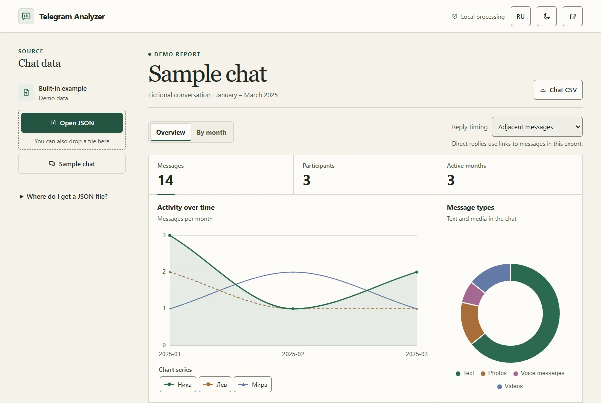

# Telegram Analyzer

**[English](#english) · [Русский](#русский)**

## English

Analyze Telegram Desktop chat exports in your browser. See who participates, when the conversation is most active, and how long responses take.

**[Try in browser →](https://orangepony4.github.io/telegram-analyzer/)**

[Analyze my export](https://orangepony4.github.io/telegram-analyzer/?view=upload) · [Download the offline ZIP](https://github.com/orangepony4/telegram-analyzer/releases/latest) · [View source code](https://github.com/orangepony4/telegram-analyzer/tree/main)

The app opens with a fictional three-month conversation. Explore the charts and download a sample CSV right away. **Analyze my export** opens the upload view, where **Sample chat** opens the example. The interface starts in English. Use **RU** in the header to switch to Russian without reopening the report.



### Analyze your own chat

1. In Telegram Desktop, open a private chat, group, or channel. Choose **Export chat history** from the chat menu, select **JSON**, and export. You can leave the media download options unchecked.
2. Select **Open JSON** or drop the exported file, usually `result.json`, into the import area. The source panel shows the reading status.
3. If you open an account export containing chat history, select a chat and choose **Analyze chat**. The report and CSV cover that chat.
4. Open **Overview** for the full chat or **By month** for a specific month. Select a name in the monthly activity chart legend to show or hide its line. The theme control in the header switches between light and dark.

### What the report measures

- Activity charts show messages by month, time of day, and day of the week. Participant details include message counts, word counts, average message length, and shared content types. The JSON records are enough to count photos and files skipped during export, as well as polls, shared contacts, and locations.
- Word counts skip standalone emoji and punctuation. Where supported by the browser, word segmentation also handles scripts such as Chinese and Japanese that are often written without spaces.
- For rich Telegram posts, word counts and message lengths include text from headings, paragraphs, lists, tables, and captions. Text blocks are separated by line breaks.
- Response times measure the interval between consecutive messages from different participants and skip service events. Across a month boundary, the interval belongs to the month of the response. The long-response threshold is adjustable in minutes.
- Modern exports use Unix timestamps or explicit offsets for response order and duration. Activity charts keep the calendar dates and times written in the export. Mixed legacy dates without offsets use an approximate wall-clock timeline for response intervals.
- Sender IDs group the same person across name changes. The app numbers identical names to distinguish participants. Reports and CSVs show names without IDs. Dated records without an identified sender count toward monthly activity and have their own trend line. Participant statistics and CSVs cover records linked to a sender.
- **Chat CSV** exports the whole chat. **Month CSV** exports the selected month. Both files contain participant names, message counts, and average message length in comma-separated UTF-8. The column headers stay the same when you change the interface language.
- Average message length counts grapheme clusters, so a compound emoji can count as one character. Browsers without `Intl.Segmenter` count Unicode code points.

### Offline use and privacy

Use a modern browser and a Telegram Desktop JSON export to analyze your own data. HTML exports use a different structure. If your import fails, check that you chose the Telegram JSON file.

To work offline, extract the [latest release ZIP](https://github.com/orangepony4/telegram-analyzer/releases/latest) and open `index.html`. Keep the `vendor` folder next to it. Charts, icons, and CSV export work offline. Chat data stays in the browser. The app serves its scripts, styles, and chart library locally, and its content security policy blocks connections made by `fetch` and `XMLHttpRequest`.

### Development

Install the dependencies and start the server from a source checkout with Node.js and npm.

```sh
npm ci
npm start
```

Open [localhost:3000](http://localhost:3000). Run `npm test` to check import, month navigation, and response time calculations. The tests use Node's built-in test runner. [Test workflow](https://github.com/orangepony4/telegram-analyzer/actions/workflows/test.yml)

Run `npm run package:offline` from a Git checkout to build `telegram-analyzer-offline.zip` from the tracked app files, documentation, and licenses in the current commit. To choose a destination, run `npm run package:offline -- ./offline-build.zip`.

[Report an issue or suggest an improvement](https://github.com/orangepony4/telegram-analyzer/issues) · [MIT license](LICENSE)

---

## Русский

**[Попробовать в браузере →](https://orangepony4.github.io/telegram-analyzer/)**

[Проанализировать свой экспорт](https://orangepony4.github.io/telegram-analyzer/?view=upload) · [Скачать ZIP для работы без интернета](https://github.com/orangepony4/telegram-analyzer/releases/latest) · [Исходный код](https://github.com/orangepony4/telegram-analyzer/tree/main) · [English](#english)

Telegram Analyzer показывает активность, участников и время ответа по экспорту из Telegram Desktop. Ссылка «Попробовать в браузере» открывает вымышленную переписку за три месяца. Можно сразу посмотреть графики и скачать пробный CSV. Ссылка «Проанализировать свой экспорт» ведёт на экран загрузки. Этот же пример там доступен через кнопку **«Демо-чат»**.

Интерфейс открывается на английском. Нажмите **RU** в шапке, чтобы перейти на русский. Текущий отчёт останется открытым.

### Как открыть свою переписку

1. В Telegram Desktop откройте личный чат, группу или канал. В меню чата выберите **«Экспорт истории чата»** и формат **JSON**. Параметры скачивания медиа можно оставить выключенными.
2. Нажмите **«Открыть JSON»** или перетащите экспортированный файл, обычно `result.json`, в область импорта. Рядом с источником появится статус чтения.
3. Если вы открыли экспорт аккаунта с историей чатов, выберите переписку и нажмите **«Показать статистику»**. Отчёт и CSV будут относиться к этому чату.
4. Во вкладке **«Обзор»** видна статистика за всё время, во вкладке **«По месяцам»** — за выбранный месяц. Нажмите имя в легенде графика динамики, чтобы скрыть или показать его линию. Кнопка в шапке переключает светлую и тёмную темы.

### Что считает анализатор

- Графики показывают активность по месяцам, времени суток и дням недели. По участникам можно посмотреть количество сообщений и слов, среднюю длину и типы отправленных материалов. JSON содержит достаточно данных для подсчёта опросов, контактов, геопозиций, фотографий и файлов, даже если вложения не были скачаны.
- При подсчёте слов отдельные эмодзи и знаки препинания пропускаются. Если браузер умеет разбивать текст на слова, это работает и для китайского, японского и других языков, где слова часто пишутся без пробелов.
- В форматированных постах Telegram слова и длина сообщения рассчитываются по тексту заголовков, абзацев, списков, таблиц и подписей. Текстовые блоки разделяются переносами строк.
- Время ответа — интервал между соседними сообщениями разных участников. Служебные события пропускаются. Если сообщения пришлись на разные месяцы, интервал относится к месяцу ответа. Порог долгого ответа можно задать в минутах.
- В современных экспортах порядок сообщений и длительность ответов определяются по Unix-времени или явному смещению часового пояса. Графики сохраняют календарное время из экспорта. Для смешанных экспортов с датами без смещения длительность ответов рассчитывается приблизительно по календарному времени.
- Идентификаторы отправителей позволяют объединить сообщения человека после смены имени. Участники с одинаковыми именами получают порядковые номера. В отчёте и CSV видны только имена. Записи с датой без определённого отправителя входят в месячную активность и показаны отдельной линией. В статистику участников и CSV входят записи с определённым отправителем.
- Кнопка **«CSV чата»** сохраняет данные по всему чату. Кнопка **«CSV месяца»** сохраняет данные за выбранный месяц. В обоих файлах содержатся имена участников, количество сообщений и средняя длина сообщения. Формат — UTF-8 с запятой в качестве разделителя. Названия столбцов сохраняются при переключении языка.
- Средняя длина считается по графемам. Например, составной эмодзи может считаться одним символом. В браузерах без `Intl.Segmenter` используются кодовые точки Unicode.

### Работа без интернета и приватность

Для своего чата нужен современный браузер и JSON-экспорт Telegram Desktop. У HTML-экспорта другая структура. Если файл не открывается, проверьте формат экспорта.

Распакуйте [ZIP из последнего релиза](https://github.com/orangepony4/telegram-analyzer/releases/latest) и откройте `index.html`. Оставьте папку `vendor` рядом с ним. Графики, значки и выгрузки CSV работают без интернета. Данные переписки обрабатываются в браузере. Скрипты, стили и библиотека графиков входят в приложение, а политика безопасности блокирует подключения через `fetch` и `XMLHttpRequest`.

### Разработка

Для локального запуска нужны Node.js и npm. Выполните команды в папке с исходным кодом.

```sh
npm ci
npm start
```

Откройте [localhost:3000](http://localhost:3000). Команда `npm test` проверяет импорт, переходы между месяцами и расчёт времени ответа с помощью встроенного тестового раннера Node.js. [Проверки на GitHub](https://github.com/orangepony4/telegram-analyzer/actions/workflows/test.yml)

Команда `npm run package:offline` собирает `telegram-analyzer-offline.zip` из файлов приложения, документации и лицензий, зафиксированных в текущем коммите Git. Чтобы указать другой путь, запустите `npm run package:offline -- ./offline-build.zip`.

[Сообщить об ошибке или предложить улучшение](https://github.com/orangepony4/telegram-analyzer/issues) · [Лицензия MIT](LICENSE)
